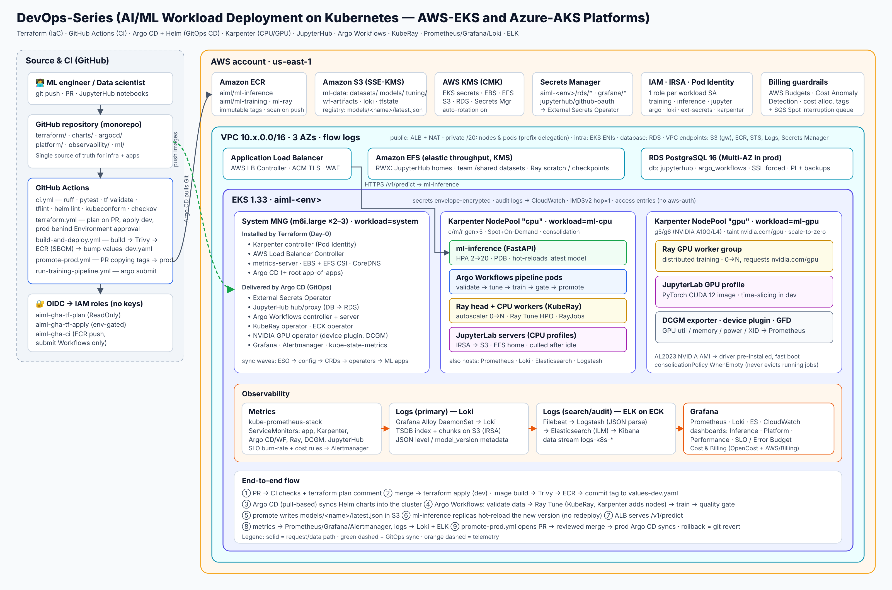

# DevOps-Series (AI/ML Workload Deployment on Kubernetes — AWS-EKS and Azure-AKS Platforms)

**Terraform · Amazon EKS · Karpenter (CPU + GPU) · GitHub Actions · Argo CD + Helm · JupyterHub · Argo Workflows · Ray/KubeRay · Prometheus · Grafana · Loki · ELK · OpenCost · SLO error budgets**

> This repository implements the **AWS-EKS** platform. The Azure-AKS variant of the same platform is the next part of the series.

## Description

This project contains an **end-to-end AI/ML workload deployment on an AWS EKS containerized environment**. It uses **Kubernetes and Helm charts** for packaging and running the workloads, **GitHub Actions** for CI/CD, and **Argo CD** for GitOps continuous delivery. It also has **full observability coverage with Prometheus and Grafana**: metrics, alerting, performance dashboards, SLO/SLI error budgets and cost/billing dashboards. Loki and the ELK stack add centralized logging.

It covers the whole ML lifecycle:

- **Develop** in multi-user JupyterHub notebooks (CPU and GPU profiles).
- **Train and tune** with Argo Workflows pipelines and distributed Ray Tune on KubeRay.
- **Gate and promote** models through an S3 model registry.
- **Serve** them through a FastAPI inference service behind an Application Load Balancer.

Karpenter provisions CPU and GPU nodes just in time. **Terraform** declares all infrastructure, and Git drives every change.

## Architecture

**Pictorial view (IT/service icons)**


**Detailed view**



## Documentation

| Document | What's in it |
|---|---|
| [docs/PLAN.md](docs/PLAN.md) | High-level plan: goals, component choices, environments, security & observability model, milestones, cost, risks |
| [docs/RUNBOOK.md](docs/RUNBOOK.md) | **Step-by-step deployment runbook** (Phase 0 → 13) + alert playbooks |
| [docs/OBSERVABILITY.md](docs/OBSERVABILITY.md) | Dashboards, **SLOs/SLIs + error-budget policy**, burn-rate alerting, **cost & billing** model |
| [docs/TROUBLESHOOTING.md](docs/TROUBLESHOOTING.md) | Symptom → cause → fix tables |
| [docs/architecture.svg](docs/architecture.svg) | Editable detailed architecture diagram |
| [docs/architecture-pictorial.png](docs/architecture-pictorial.png) | Pictorial diagram with AWS / Kubernetes / tool icons. Source: [docs/diagrams/architecture_pictorial.py](docs/diagrams/architecture_pictorial.py) (`python docs/diagrams/architecture_pictorial.py` regenerates it) |

## What gets deployed

| Layer | Components |
|---|---|
| **AWS foundation** (Terraform) | VPC (3 AZ, public/private/intra/database subnets, NAT, flow logs, VPC endpoints) · KMS CMK · EKS 1.33 + managed add-ons (VPC CNI, CoreDNS, EBS CSI, EFS CSI, Pod Identity) · Karpenter IAM + SQS interruption queue · S3 (data/model registry, workflow artifacts, Loki) · EFS · RDS PostgreSQL 16 · Secrets Manager · IRSA roles per workload · ECR · GitHub OIDC roles |
| **Day-0 platform** (Terraform → Helm) | AWS Load Balancer Controller · metrics-server · Karpenter · Argo CD + root app-of-apps |
| **GitOps platform** (Argo CD) | Karpenter NodePools (CPU Spot/On-Demand, NVIDIA GPU) · External Secrets · NVIDIA GPU Operator · KubeRay operator · Argo Workflows · JupyterHub · kube-prometheus-stack · Loki + Alloy · ECK operator + Elasticsearch/Logstash/Kibana/Filebeat |
| **Observability+** (Argo CD) | OpenCost (cost allocation) · `observability-rules` (SLO/SLI error budgets with multi-window burn-rate alerts, cost recording rules + budget/idle/GPU alerts) · Grafana dashboards: Cost & Billing, Performance, SLO / Error Budget, Inference, Platform · CloudWatch datasource for the AWS bill |
| **Billing guardrails** (Terraform) | AWS Budgets per environment (total + EC2 compute, 80 %/100 %/forecast alerts) · Cost Anomaly Detection · cost allocation tags on every resource (incl. Karpenter nodes, EBS volumes, ALBs) |
| **ML workloads** (Argo CD) | `ray-cluster` (autoscaling CPU+GPU workers) · `ml-pipelines` (validate → Ray Tune → train → gate → promote, nightly CronWorkflow) · `ml-inference` (FastAPI, HPA, ALB, SLO alerts) |
| **CI/CD** (GitHub Actions) | lint/test/validate/scan · Terraform plan on PR + gated apply · build → Trivy → ECR (+SBOM) → GitOps tag bump · promote-to-prod PR · run training pipeline |

## Repository layout

```
.
├── terraform/
│   ├── global/                 # once per account: tfstate bucket, GitHub OIDC + roles, ECR
│   ├── stack/                  # one environment: KMS, VPC, EKS, Karpenter, S3/EFS, RDS, IRSA, Day-0 platform
│   ├── envs/{dev,prod}/        # terraform.tfvars + backend.hcl per environment
│   └── modules/
│       ├── kms/  ecr/  github-oidc/
│       ├── storage/            # S3 buckets + EFS
│       ├── database/           # RDS PostgreSQL + Secrets Manager
│       ├── workload-identity/  # IRSA roles for every workload
│       ├── cost-guardrails/    # AWS Budgets per environment
│       └── platform/           # storage classes, LBC, metrics-server, Karpenter, Argo CD, root app
├── argocd/app-of-apps/         # Helm chart rendering one Argo CD Application per component (sync-waves)
├── platform/                   # values for third-party charts: jupyterhub, argo-workflows, gpu-operator, kuberay, ESO, ECK
├── observability/
│   ├── kube-prometheus-stack/  loki/  alloy/  opencost/
│   └── extras/                 # Grafana dashboards (cost, performance, SLO, ...), ServiceMonitors, platform alerts
├── charts/                     # our Helm charts
│   ├── ml-inference/           # FastAPI model server
│   ├── ml-pipelines/           # Argo WorkflowTemplate + CronWorkflow + RBAC
│   ├── ray-cluster/            # RayCluster (CPU + GPU groups) + EFS scratch
│   ├── karpenter-nodepools/    # EC2NodeClasses + NodePools
│   ├── observability-rules/    # SLO/SLI error-budget engine + cost recording rules & alerts (per-env values)
│   ├── platform-config/        # namespaces, ExternalSecrets, Postgres db-init Job, Jupyter SA/PVC
│   └── elastic-stack/          # ECK: Elasticsearch, Kibana, Logstash, Filebeat, ILM
├── ml/
│   ├── common/mlstore.py       # S3/local model registry (latest.json pointer)
│   ├── training/               # validate_data, ray_tune, train (quality gate), promote/rollback + Dockerfiles
│   ├── inference/              # FastAPI app with Prometheus metrics + hot model reload
│   └── tests/                  # pytest (runs locally, no AWS needed)
├── .github/workflows/          # ci, terraform, build-and-deploy, promote-prod, run-training-pipeline
├── scripts/                    # configure, bootstrap-global, deploy-env, wait-for-apps, access, smoke-test, teardown
├── docs/                       # PLAN, RUNBOOK, TROUBLESHOOTING, architecture
└── Makefile
```

## Quick start (dev)

> Full detail, expected output and fixes for every step: **[docs/RUNBOOK.md](docs/RUNBOOK.md)**.

```bash
# 0. prerequisites: terraform>=1.10, aws v2, kubectl, helm, jq, yq, gh, argo; admin role in AWS
aws sts get-caller-identity

# 1. render account id + your admin role into the repo, push (Argo CD reads from Git)
make configure && git commit -am "chore: configure account" && git push

# 2. global layer: tfstate bucket, GitHub OIDC roles, ECR
make global
#    -> set the printed role ARNs as GitHub repo variables, create Environments dev/prod

# 3. build images before the cluster exists (bumps tags in values-dev.yaml)
gh workflow run build-and-deploy.yml && gh run watch && git pull

# 4. provision dev (VPC, EKS, Karpenter, RDS, EFS, ... + Argo CD) and wait for GitOps
make deploy ENV=dev

# 5. JupyterHub GitHub OAuth secret (see runbook Phase 6)
aws secretsmanager put-secret-value --secret-id aiml-dev/jupyterhub/github-oauth \
  --secret-string '{"client_id":"...","client_secret":"..."}'

# 6. train -> tune on Ray -> gate -> promote; inference hot-loads the model
gh workflow run run-training-pipeline.yml -f environment=dev

# 7. verify + open UIs
make smoke ENV=dev
make access     # Argo CD :8080 · Grafana :3000 · Argo WF :2746 · JupyterHub :8000 · Ray :8265 · Kibana :5601 · OpenCost :9091
                # Grafana folders: FinOps › Cost & Billing · ML Platform › Performance · SRE › SLO / Error Budgets
```

Call the model:

```bash
ALB=$(kubectl -n ml-serving get ingress ml-inference -o jsonpath='{.status.loadBalancer.ingress[0].hostname}')
curl -s http://$ALB/v1/predict -H 'content-type: application/json' -d '{"instances": [[5.1,3.5,1.4,0.2]]}'
# {"model":"iris-classifier","model_version":"20261110...","predictions":[{"label":"setosa",...}]}
```

## Local development (no AWS)

```bash
cd ml
python -m venv .venv && source .venv/bin/activate
pip install -r requirements-dev.txt
pytest -q                                    # 12 tests: data gate, training gate, promote/rollback, API

# train + serve locally against a directory-backed registry
PYTHONPATH=common:training python -m trainer.train --model-store ./artifacts/models --promote
PYTHONPATH=common:inference MODEL_STORE_URI=./artifacts/models uvicorn app.main:app --port 8080
```

## Key design decisions

- **Terraform installs only what GitOps needs to start** (Karpenter, LB controller, Argo CD + one root Application). Everything else is in Git and reconciled by Argo CD → drift is self-healed, every change is a PR.
- **Karpenter instead of node groups for workloads** — just-in-time capacity, Spot in dev, GPU **scale-to-zero**, consolidation; GPU NodePool only reclaims *empty* nodes so long jobs are never evicted.
- **Model registry = S3 + pointer file.** Promotion/rollback is an atomic `latest.json` write; inference replicas hot-reload → model changes need no deployment. Images and models are versioned independently.
- **Build once, promote everywhere**: the same immutable image tag flows dev → prod through a reviewed PR.
- **Secrets never touch Git**: Terraform writes them to Secrets Manager (KMS); External Secrets syncs them; RDS app roles/databases are created by an idempotent hook Job.
- **SLOs as code**: each SLO is two PromQL expressions in `charts/observability-rules/values.yaml`; the chart generates the multi-window burn-rate rules, error-budget series and alerts, and the SLO dashboard discovers new SLOs automatically.
- **Cost from three angles**: OpenCost for real-time allocation (namespace, NodePool, GPU, idle), the AWS bill via CloudWatch for truth, and AWS Budgets + Anomaly Detection for guardrails. All are tied together by consistent `Project`/`Environment` tags.
- **Two log pipelines on purpose**: Loki (cheap, all namespaces, correlated with metrics in Grafana) and ELK (full-text search, longer retention for ML/platform namespaces). Disable either in `argocd/app-of-apps/values.yaml`.

## Cost

dev idle baseline ≈ **$550–650/month** (EKS, 2 system nodes, NAT, VPC endpoints, RDS, small CPU pool). GPUs cost only while in use (g5.xlarge ≈ $1/h). Run `make destroy ENV=dev` when you are done. Details in [PLAN.md §7](docs/PLAN.md#7-cost-guide-us-east-1-on-demand-list-prices-rounded).

## Versions

| Component | Version |
|---|---|
| Terraform / AWS provider | ≥ 1.10 / ~> 5.95 |
| EKS / Karpenter | 1.33 / 1.1.1 |
| Argo CD chart / Argo Workflows chart | 7.7.10 / 0.45.1 |
| JupyterHub (z2jh) / KubeRay / Ray | 4.0.0 / 1.2.2 / 2.40.0 |
| kube-prometheus-stack / Loki / Alloy | 66.2.1 / 6.24.0 / 0.10.1 |
| ECK / Elastic stack | 2.16.0 / 8.17.0 |
| NVIDIA GPU operator / External Secrets | v24.9.1 / 0.12.1 |
| OpenCost chart | 2.5.33 |

All chart versions are pinned in `argocd/app-of-apps/values.yaml` and `terraform/modules/platform/variables.tf`; upgrade them through PRs (dev first).

---

Part of the **DevOps Series** by Asim Khan.
