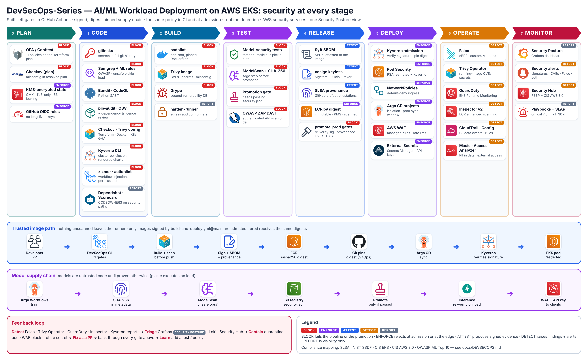
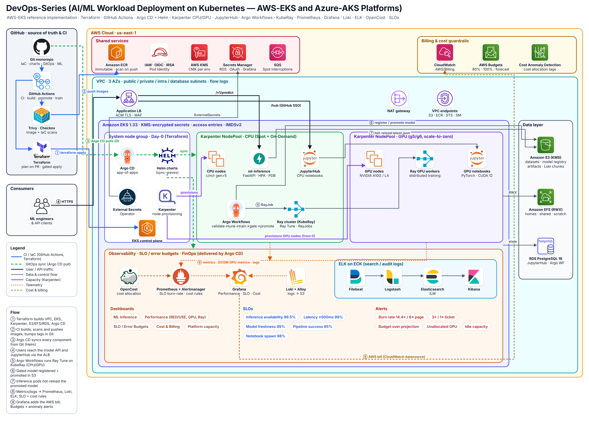

# DevSecOps-Series (AI/ML Workload Deployment on Kubernetes —AWS-EKS Platform)

**Terraform · Amazon EKS · Karpenter (CPU + GPU) · GitHub Actions · Argo CD + Helm · JupyterHub · Argo Workflows · Ray/KubeRay · Prometheus · Grafana · Loki · ELK · OpenCost · SLO error budgets**
**+ Security at every stage:** gitleaks · Semgrep · Bandit · CodeQL · pip-audit · OSV · Checkov · Trivy · Grype · Conftest/OPA · Kyverno · zizmor · hadolint · Syft SBOM · cosign (Sigstore) · SLSA provenance · ModelScan · OWASP ZAP · Falco · Trivy Operator · AWS WAF · GuardDuty · Security Hub · Inspector · Config · CloudTrail · Macie

> This repository implements the **AWS-EKS** platform. The Azure-AKS variant of the same platform is the next part of the series.
> It is the **DevSecOps edition** of [DevOps-Series-AI-ML-Workload-deployment-on-AWS-EKS](https://github.com/Cloud-Deployment-Resources-asimshahibm/DevOps-Series-AI-ML-Workload-deployment-on-AWS-EKS): the same platform, with security built into every stage of the pipeline.

## Description

This project contains an **end-to-end AI/ML workload deployment on an AWS EKS containerized environment**. It uses **Kubernetes and Helm charts** for packaging and running the workloads, **GitHub Actions** for CI/CD, and **Argo CD** for GitOps continuous delivery. It also has **full observability coverage with Prometheus and Grafana**: metrics, alerting, performance dashboards, SLO/SLI error budgets and cost/billing dashboards. Loki and the ELK stack add centralized logging.

This **DevSecOps** edition adds a **blocking security gate at every stage**: plan, code, build, test, release, deploy, operate and monitor. Only scanned, **signed** and digest-pinned images built by this repository's pipeline are admitted to the cluster. Model artifacts are **hashed and scanned for malicious pickle code** before they are promoted, and verified again before they are served. Runtime threats are detected with Falco, Trivy Operator and the AWS security services. Everything is visible on a Grafana *Security Posture* dashboard, with alerts that link to playbooks.

It covers the whole ML lifecycle:

- **Develop** in multi-user JupyterHub notebooks (CPU and GPU profiles).
- **Train and tune** with Argo Workflows pipelines and distributed Ray Tune on KubeRay.
- **Scan, gate and promote** models through an S3 model registry.
- **Serve** them through an authenticated FastAPI inference service behind an Application Load Balancer and AWS WAF.

Karpenter provisions CPU and GPU nodes just in time. **Terraform** declares all infrastructure, and Git drives every change.

## Security at every stage



| Stage | Gate (blocking unless noted) | Where |
|---|---|---|
| **Plan** | OPA/Conftest policies + Checkov on the Terraform **plan** (encryption, no public data, private prod EKS API) | `terraform.yml`, `policy/terraform` |
| **Code** | gitleaks (full history) · Semgrep (+ custom ML rules) · Bandit · CodeQL · pip-audit · OSV · dependency review + licence policy · Checkov · Trivy config · Kyverno CLI on rendered charts · zizmor + actionlint | `ci.yml`, `codeql.yml` |
| **Build** | hadolint · image built locally → **Trivy + Grype must pass before push** · hardened runners | `build-and-deploy.yml` |
| **Test** | unit + model-security tests · **ModelScan** + SHA-256 in the training pipeline · promotion requires a passing scan · OWASP **ZAP** DAST on dev | `ml/`, `charts/ml-pipelines`, `dast.yml` |
| **Release** | Syft **SBOM** · **cosign keyless signature** · SBOM attestation · **SLSA provenance** · verified before CD · prod promotion re-verifies signature, provenance, fresh CVE scan, DAST | `build-and-deploy.yml`, `promote-prod.yml` |
| **Deploy** | **Kyverno**: verified signature + digest, ECR-only, no `latest`, restricted pod security, limits, no host access · PSA labels · NetworkPolicies · Argo CD project isolation + prod sync window · AWS WAF on the ALB · API keys | `charts/security-policies`, `argocd/` |
| **Operate** | Falco (custom ML rules) · Trivy Operator · model integrity re-check at load · GuardDuty (EKS Runtime) · Security Hub (FSBP + CIS) · Inspector (ECR) · Config · CloudTrail data events · Access Analyzer · Macie | `platform/`, `terraform/modules/security-baseline` |
| **Monitor** | Grafana *Security Posture* dashboard · security alerts → playbooks · authorized-traffic SLO · remediation SLAs | `observability/extras`, `charts/observability-rules` |

Full detail, the ML threat model, compliance mapping (SLSA, NIST SSDF, CIS EKS, OWASP ML) and incident playbooks: **[docs/DEVSECOPS.md](docs/DEVSECOPS.md)**.

## Architecture

**Pictorial view (IT/service icons)**



**Detailed view**


## Documentation

| Document | What's in it |
|---|---|
| [docs/DEVSECOPS.md](docs/DEVSECOPS.md) | **Security at every stage**: gates per stage, ML threat model, compliance mapping, exceptions, security playbooks |
| [docs/PLAN.md](docs/PLAN.md) | High-level plan: goals, component choices, environments, security & observability model, milestones, cost, risks |
| [docs/RUNBOOK.md](docs/RUNBOOK.md) | **Step-by-step deployment runbook** (Phase 0 → 13, incl. security setup and verification) + alert playbooks |
| [docs/OBSERVABILITY.md](docs/OBSERVABILITY.md) | Dashboards, **SLOs/SLIs + error-budget policy**, burn-rate alerting, **cost & billing** model |
| [docs/TROUBLESHOOTING.md](docs/TROUBLESHOOTING.md) | Symptom → cause → fix tables |
| [docs/architecture.svg](docs/architecture.svg) | Editable detailed architecture diagram |
| [docs/devsecops-pipeline.png](docs/devsecops-pipeline.png) | Pictorial DevSecOps pipeline: security tools per stage. Source: [docs/diagrams/devsecops_pipeline.py](docs/diagrams/devsecops_pipeline.py) |
| [docs/architecture-pictorial.png](docs/architecture-pictorial.png) | Pictorial diagram with AWS / Kubernetes / tool icons. Source: [docs/diagrams/architecture_pictorial.py](docs/diagrams/architecture_pictorial.py) (`python docs/diagrams/architecture_pictorial.py` regenerates it) |

## What gets deployed

| Layer | Components |
|---|---|
| **AWS foundation** (Terraform) | VPC (3 AZ, public/private/intra/database subnets, NAT, flow logs, VPC endpoints) · KMS CMK · EKS 1.33 + managed add-ons (VPC CNI, CoreDNS, EBS CSI, EFS CSI, Pod Identity) · Karpenter IAM + SQS interruption queue · S3 (data/model registry, workflow artifacts, Loki) · EFS · RDS PostgreSQL 16 · Secrets Manager · IRSA roles per workload · ECR · GitHub OIDC roles |
| **Day-0 platform** (Terraform → Helm) | AWS Load Balancer Controller · metrics-server · Karpenter · Argo CD + root app-of-apps |
| **GitOps platform** (Argo CD) | Karpenter NodePools (CPU Spot/On-Demand, NVIDIA GPU) · External Secrets · NVIDIA GPU Operator · KubeRay operator · Argo Workflows · JupyterHub · kube-prometheus-stack · Loki + Alloy · ECK operator + Elasticsearch/Logstash/Kibana/Filebeat |
| **Observability+** (Argo CD) | OpenCost (cost allocation) · `observability-rules` (SLO/SLI error budgets with multi-window burn-rate alerts, cost recording rules + budget/idle/GPU alerts) · Grafana dashboards: Cost & Billing, Performance, SLO / Error Budget, Inference, Platform · CloudWatch datasource for the AWS bill |
| **Billing guardrails** (Terraform) | AWS Budgets per environment (total + EC2 compute, 80 %/100 %/forecast alerts) · Cost Anomaly Detection · cost allocation tags on every resource (incl. Karpenter nodes, EBS volumes, ALBs) |
| **ML workloads** (Argo CD) | `ray-cluster` (autoscaling CPU+GPU workers) · `ml-pipelines` (validate → Ray Tune → train → gate → promote, nightly CronWorkflow) · `ml-inference` (FastAPI, HPA, ALB, SLO alerts) |
| **Security platform** (Argo CD) | Kyverno + `security-policies` (signature verification, pod security, registries, NetworkPolicies) · Policy Reporter · Falco + Falcosidekick · Trivy Operator · Grafana *Security Posture* dashboard + security alerts |
| **AWS security** (Terraform) | GuardDuty (EKS Runtime Monitoring) · Security Hub (FSBP, CIS 3.0) · Inspector v2 (ECR enhanced scanning) · AWS Config · CloudTrail (S3 data events) · IAM Access Analyzer · Macie · WAFv2 for the ALB · customer-managed KMS everywhere, including Terraform state |
| **CI/CD** (GitHub Actions) | DevSecOps CI (11 gates) · CodeQL · Scorecard · Terraform plan + OPA/Checkov gates + gated apply · build → scan → push → SBOM → sign → attest → verify → digest-pinned GitOps bump · ZAP DAST · verified promote-to-prod PR · run training pipeline |

## Repository layout

```
.
├── terraform/
│   ├── global/                 # once per account: tfstate bucket, GitHub OIDC + roles, ECR
│   ├── stack/                  # one environment: KMS, VPC, EKS, Karpenter, S3/EFS, RDS, IRSA, Day-0 platform
│   ├── envs/{dev,prod}/        # terraform.tfvars + backend.hcl per environment
│   └── modules/
│       ├── kms/  ecr/  github-oidc/
│       ├── storage/            # S3 buckets + EFS
│       ├── database/           # RDS PostgreSQL + Secrets Manager
│       ├── workload-identity/  # IRSA roles for every workload
│       ├── cost-guardrails/    # AWS Budgets per environment
│       ├── security-baseline/  # GuardDuty, Security Hub, Inspector, Config, CloudTrail, Access Analyzer, Macie
│       ├── waf/                # WAFv2 web ACL for the ALB
│       └── platform/           # storage classes, LBC, metrics-server, Karpenter, Argo CD, root app
├── argocd/app-of-apps/         # Helm chart rendering one Argo CD Application per component (sync-waves)
├── platform/                   # values for third-party charts: jupyterhub, argo-workflows, gpu-operator, kuberay, ESO, ECK,
│                               #   kyverno, policy-reporter, falco, trivy-operator
├── policy/terraform/           # OPA/Rego policies (+ unit tests) evaluated on every Terraform plan
├── observability/
│   ├── kube-prometheus-stack/  loki/  alloy/  opencost/
│   └── extras/                 # Grafana dashboards (cost, performance, SLO, ...), ServiceMonitors, platform alerts
├── charts/                     # our Helm charts
│   ├── ml-inference/           # FastAPI model server
│   ├── ml-pipelines/           # Argo WorkflowTemplate + CronWorkflow + RBAC
│   ├── ray-cluster/            # RayCluster (CPU + GPU groups) + EFS scratch
│   ├── karpenter-nodepools/    # EC2NodeClasses + NodePools
│   ├── observability-rules/    # SLO/SLI error-budget engine + cost recording rules & alerts (per-env values)
│   ├── security-policies/      # Kyverno ClusterPolicies + NetworkPolicies (+ kyverno CLI tests)
│   ├── platform-config/        # namespaces (Pod Security Admission labels), ExternalSecrets, Postgres db-init Job, Jupyter SA/PVC
│   └── elastic-stack/          # ECK: Elasticsearch, Kibana, Logstash, Filebeat, ILM
├── ml/
│   ├── common/mlstore.py       # S3/local model registry (latest.json pointer)
│   ├── training/               # validate_data, ray_tune, train (quality gate), scan_model (ModelScan), promote/rollback + Dockerfiles
│   ├── inference/              # FastAPI app: API-key auth, integrity-verified model load, Prometheus metrics, hot reload
│   └── tests/                  # pytest (runs locally, no AWS needed)
├── .github/                    # workflows (ci, codeql, scorecard, terraform, build-and-deploy, dast, promote-prod,
│                               #   run-training-pipeline), dependabot.yml, CODEOWNERS
├── .semgrep/ .zap/             # custom ML Semgrep rules, ZAP rule config
├── .checkov.yaml trivy.yaml .trivyignore .gitleaks.toml .hadolint.yaml zizmor.yml   # scanner configs + documented exceptions
├── scripts/                    # configure, bootstrap-global, deploy-env, render-security-outputs, policy-check,
│                               #   wait-for-apps, access, smoke-test, teardown
├── docs/                       # DEVSECOPS, PLAN, RUNBOOK, OBSERVABILITY, TROUBLESHOOTING, diagrams
├── SECURITY.md                 # vulnerability reporting + remediation SLAs
└── Makefile
```

## Quick start (dev)

> Full detail, expected output and fixes for every step: **[docs/RUNBOOK.md](docs/RUNBOOK.md)**.

```bash
# 0. prerequisites: terraform>=1.10, aws v2, kubectl, helm, jq, yq, gh, argo; admin role in AWS
aws sts get-caller-identity

# 1. render account id + your admin role into the repo, push (Argo CD reads from Git)
make configure && git commit -am "chore: configure account" && git push

# 2. global layer: tfstate bucket, GitHub OIDC roles, ECR
make global
#    -> set the printed role ARNs as GitHub repo variables, create Environments dev/prod

# 3. build images before the cluster exists (bumps tags in values-dev.yaml)
gh workflow run build-and-deploy.yml && gh run watch && git pull

# 4. provision dev (VPC, EKS, Karpenter, RDS, EFS, WAF, ... + Argo CD) and wait for GitOps
make deploy ENV=dev
scripts/render-security-outputs.sh dev && git commit -am "security(dev): attach WAF" && git push
gh variable set DEV_INFERENCE_URL --body "http://$(kubectl -n ml-serving get ingress ml-inference -o jsonpath='{.status.loadBalancer.ingress[0].hostname}')"
gh secret set DAST_API_KEY --body "$(aws secretsmanager get-secret-value --secret-id aiml-dev/inference/api-keys --query SecretString --output text | jq -r .keys)"

# 5. JupyterHub GitHub OAuth secret (see runbook Phase 6)
aws secretsmanager put-secret-value --secret-id aiml-dev/jupyterhub/github-oauth \
  --secret-string '{"client_id":"...","client_secret":"..."}'

# 6. train -> tune on Ray -> gate -> promote; inference hot-loads the model
gh workflow run run-training-pipeline.yml -f environment=dev

# 7. verify + open UIs
make smoke ENV=dev   # includes security checks: unsigned image rejected, 401 without API key, Falco/Kyverno/Trivy up
make access     # Argo CD :8080 · Grafana :3000 · Argo WF :2746 · JupyterHub :8000 · Ray :8265 · Kibana :5601 · OpenCost :9091
                # Grafana folders: FinOps › Cost & Billing · ML Platform › Performance · SRE › SLO / Error Budgets · Security › Security Posture
```

Call the model:

```bash
ALB=$(kubectl -n ml-serving get ingress ml-inference -o jsonpath='{.status.loadBalancer.ingress[0].hostname}')
API_KEY=$(aws secretsmanager get-secret-value --secret-id aiml-dev/inference/api-keys --query SecretString --output text | jq -r .keys)
curl -s http://$ALB/v1/predict -H 'content-type: application/json' -H "x-api-key: $API_KEY" -d '{"instances": [[5.1,3.5,1.4,0.2]]}'
# {"model":"iris-classifier","model_version":"20261110...","predictions":[{"label":"setosa",...}]}
```

## Local development (no AWS)

```bash
cd ml
python -m venv .venv && source .venv/bin/activate
pip install -r requirements-dev.txt
pytest -q                                    # 21 tests: data gate, training gate, promote/rollback, API,
                                             # model security (tamper, malicious pickle via ModelScan, auth, headers)

# train + serve locally against a directory-backed registry
export PYTHONPATH=common:training:inference
python -m trainer.train --model-store ./artifacts/models --version-file /tmp/v && V=$(cat /tmp/v)
python -m trainer.scan_model --model-store ./artifacts/models --version "$V"   # ModelScan + SHA-256 -> security.json
python -m trainer.promote    --model-store ./artifacts/models --version "$V"   # refuses unscanned / tampered models
export API_KEY=$(openssl rand -hex 16)          # any value; auth is on by default
MODEL_STORE_URI=./artifacts/models API_KEYS="$API_KEY" uvicorn app.main:app --port 8080
curl -s localhost:8080/v1/predict -H "x-api-key: $API_KEY" -H 'content-type: application/json' -d '{"instances": [[5.1,3.5,1.4,0.2]]}'
```

## Key design decisions

- **Terraform installs only what GitOps needs to start** (Karpenter, LB controller, Argo CD + one root Application). Everything else is in Git and reconciled by Argo CD → drift is self-healed, every change is a PR.
- **Karpenter instead of node groups for workloads** — just-in-time capacity, Spot in dev, GPU **scale-to-zero**, consolidation; GPU NodePool only reclaims *empty* nodes so long jobs are never evicted.
- **Model registry = S3 + pointer file.** Promotion/rollback is an atomic `latest.json` write; inference replicas hot-reload → model changes need no deployment. Images and models are versioned independently.
- **Build once, promote everywhere — by digest**: the same signed `sha256` digest flows dev → prod through a reviewed PR, and is re-verified (signature, provenance, fresh CVE scan, DAST) before the PR is opened.
- **Same policy in CI and cluster**: the Kyverno policies that guard admission also run in CI against the rendered charts, so a PR can't merge what the cluster would reject.
- **Models are treated as untrusted code** until proven otherwise: hashed, ModelScan-ed, promoted only with a passing `security.json`, and re-verified on every load.
- **Fail closed, document exceptions**: every scanner blocks; every suppression is a reviewed line with a reason (`.checkov.yaml`, `.trivyignore`, inline skips).
- **Secrets never touch Git**: Terraform writes them to Secrets Manager (KMS); External Secrets syncs them; RDS app roles/databases are created by an idempotent hook Job.
- **SLOs as code**: each SLO is two PromQL expressions in `charts/observability-rules/values.yaml`; the chart generates the multi-window burn-rate rules, error-budget series and alerts, and the SLO dashboard discovers new SLOs automatically.
- **Cost from three angles**: OpenCost for real-time allocation (namespace, NodePool, GPU, idle), the AWS bill via CloudWatch for truth, and AWS Budgets + Anomaly Detection for guardrails. All are tied together by consistent `Project`/`Environment` tags.
- **Two log pipelines on purpose**: Loki (cheap, all namespaces, correlated with metrics in Grafana) and ELK (full-text search, longer retention for ML/platform namespaces). Disable either in `argocd/app-of-apps/values.yaml`.

## Cost

dev idle baseline ≈ **$550–650/month** (EKS, 2 system nodes, NAT, VPC endpoints, RDS, small CPU pool). GPUs cost only while in use (g5.xlarge ≈ $1/h). Run `make destroy ENV=dev` when you are done. Details in [PLAN.md §7](docs/PLAN.md#7-cost-guide-us-east-1-on-demand-list-prices-rounded).

## Versions

| Component | Version |
|---|---|
| Terraform / AWS provider | ≥ 1.10 / ~> 5.95 |
| EKS / Karpenter | 1.33 / 1.1.1 |
| Argo CD chart / Argo Workflows chart | 7.7.10 / 0.45.1 |
| JupyterHub (z2jh) / KubeRay / Ray | 4.0.0 / 1.2.2 / 2.40.0 |
| kube-prometheus-stack / Loki / Alloy | 66.2.1 / 6.24.0 / 0.10.1 |
| ECK / Elastic stack | 2.16.0 / 8.17.0 |
| NVIDIA GPU operator / External Secrets | v24.9.1 / 0.12.1 |
| OpenCost chart | 2.5.33 |
| Kyverno chart / Policy Reporter / Falco / Trivy Operator | 3.9.2 / 3.11.2 / 9.2.2 / 0.33.0 |
| Trivy / cosign / ModelScan / Checkov / zizmor | 0.76.1 / 2.4.1 / 0.8.8 / 3.2.334 / 1.31.1 |

All chart versions are pinned in `argocd/app-of-apps/values.yaml` and `terraform/modules/platform/variables.tf`; upgrade them through PRs (dev first).

---

Part of the **DevOps / DevSecOps Series** by Asim Khan. Found a vulnerability? See [SECURITY.md](SECURITY.md).
