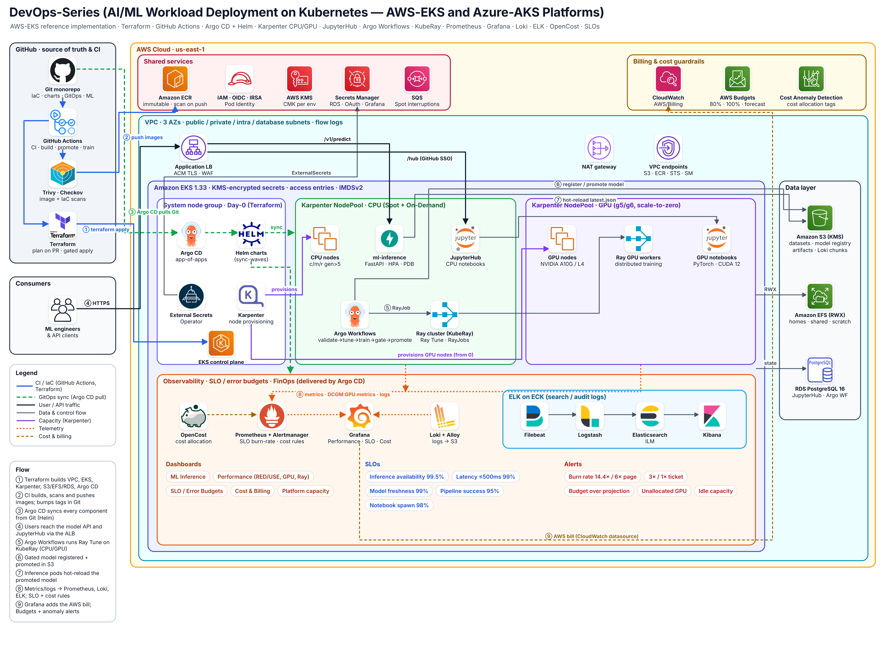
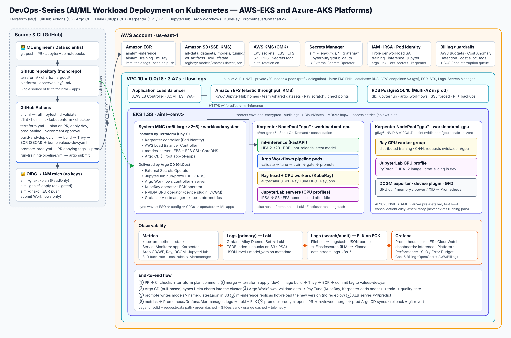

# High-Level Plan — AI/ML Workload Platform on EKS

## 1. Objective

Stand up a production-grade, repeatable platform on AWS for the full ML
lifecycle — **explore → train → tune → serve → observe** — where every
change to infrastructure, platform components and models flows through Git.

| Capability | Component | Why this choice |
|---|---|---|
| Infrastructure as Code | **Terraform** (+ official `terraform-aws-modules`) | Reviewed plans, drift detection, one stack per env |
| Continuous Integration | **GitHub Actions** + OIDC | No stored AWS keys; plan on PR, gated apply |
| Continuous Delivery | **Argo CD** + **Helm** (app-of-apps) | Pull-based GitOps, self-healing, rollback = `git revert` |
| Container registry | **Amazon ECR** | Immutable tags, scan on push, IAM-native |
| Compute | **EKS 1.33** + **Karpenter** | Just-in-time CPU **and GPU** nodes, Spot, scale-to-zero |
| GPU enablement | **NVIDIA GPU Operator** (driver-less on AL2023 NVIDIA AMI) | Device plugin, DCGM metrics, time-slicing |
| Model development | **JupyterHub** (z2jh) | Multi-user notebooks, CPU/GPU profiles, GitHub SSO |
| Workflow orchestration | **Argo Workflows** | K8s-native DAGs, artifacts on S3, archive in Postgres |
| Distributed computing | **Ray / KubeRay** | HPO (Ray Tune), distributed training, autoscaling workers |
| Object storage | **S3** (SSE-KMS) | Datasets, model registry, workflow artifacts, Loki chunks |
| Shared file storage | **EFS** (CSI, access points) | RWX home dirs, team datasets, Ray scratch |
| Relational state | **RDS PostgreSQL 16** | JupyterHub DB, Argo Workflows archive |
| Secrets | **Secrets Manager** + **External Secrets Operator** | No secrets in Git; rotation without redeploys |
| Identity | **IAM / IRSA / EKS Pod Identity**, EKS access entries | Least-privilege per workload |
| Encryption | **KMS CMK** | EKS secrets, EBS, EFS, S3, RDS, Secrets Manager |
| Metrics & alerting | **Prometheus** + **Alertmanager** + **Grafana** | SLOs, GPU/Karpenter/pipeline alerts, dashboards |
| Cost & billing | **OpenCost**, CloudWatch `AWS/Billing`, **AWS Budgets**, **Cost Anomaly Detection** | Real-time allocation per namespace/GPU + the real bill + guardrails |
| SLOs | `observability-rules` chart (multi-window multi-burn-rate) | Error budgets drive release decisions |
| Logs | **Loki** (+ Alloy) and **ELK** on ECK (Filebeat → Logstash → ES → Kibana) | Loki for cheap ops logs in Grafana; ELK for full-text search/audit |
| Networking & security | VPC (3 AZ), NAT, VPC endpoints, ALB + ACM (+WAF), SGs, flow logs | Private nodes, private AWS API access |

## 2. Architecture



Detailed view:



**Layering** (each layer only depends on the one below it):

1. **Global** (`terraform/global`) — once per account: state bucket, GitHub OIDC + roles, ECR.
2. **Environment stack** (`terraform/stack` × `envs/dev|prod`) — KMS, VPC + endpoints, EKS + system node group, Karpenter IAM/SQS, S3 + EFS, RDS + Secrets, IRSA roles, and the *Day-0 platform*: LB controller, metrics-server, Karpenter, Argo CD and **one** root Application.
3. **GitOps platform** (`argocd/app-of-apps` → `platform/`, `observability/`, `charts/`) — everything else, ordered by sync-waves.
4. **ML workloads** (`charts/ml-*`, `charts/ray-cluster`) — images built by CI, tags bumped in Git.

### Environments

| | dev | prod |
|---|---|---|
| VPC CIDR | 10.10.0.0/16 | 10.20.0.0/16 |
| NAT | single | one per AZ |
| System nodes | 2 × m6i.large | 3 × m6i.large |
| Karpenter CPU | Spot + On-Demand, 64 vCPU cap | On-Demand, 400 vCPU cap |
| Karpenter GPU | g5/g6, max 2 GPUs, time-sliced ×4 | g5/g6, max 16 GPUs, exclusive |
| RDS | db.t4g.medium, single-AZ | db.r7g.large, Multi-AZ, deletion protection |
| Argo CD | single replica | HA (redis-ha) |
| Prometheus | 1 replica, 15d | 2 replicas, 30d |
| Elasticsearch | 1 node, 7d ILM | 3 nodes, 30d ILM |
| Training schedule | on demand | nightly CronWorkflow, manual approval gate |
| Deploy trigger | merge to `main` (auto) | reviewed PR from `promote-prod.yml` |

## 3. Delivery flow

```
 PR ──► ci.yml (ruff, pytest, tf validate/tflint, helm lint + kubeconform, checkov, trivy)
   └──► terraform.yml  plan dev+prod → PR comment
merge ─► terraform.yml  apply dev (prod: manual dispatch + Environment approval)
     └► build-and-deploy.yml  build 3 images → Trivy (CRITICAL fails) → ECR (+SBOM, provenance)
                              → commit new tag to charts/*/values-dev.yaml
                              → Argo CD (dev) syncs  ml-inference · ml-pipelines · ray-cluster
run-training-pipeline.yml / nightly CronWorkflow
     → Argo Workflow: validate-data → Ray Tune (RayJob) → train → quality gate → [approval] → promote
     → S3 models/<name>/latest.json updated → inference replicas hot-reload (no redeploy)
promote-prod.yml → PR copying tags to values-prod.yaml → review + merge → Argo CD (prod) syncs
```

**Rollback paths**

| What broke | Rollback |
|---|---|
| Bad image / chart change | `git revert` the deploy commit → Argo CD syncs previous state |
| Bad model | `python -m trainer.promote --rollback` (or re-run promote with an older version) — pointer swap, seconds |
| Bad infra change | `git revert` → `terraform.yml` plan/apply |
| Platform component upgrade | revert chart version bump in `argocd/app-of-apps/values.yaml` |

## 4. Security model

- **No long-lived credentials**: GitHub → AWS via OIDC; pods → AWS via IRSA / Pod Identity; humans via SSO roles mapped with EKS access entries.
- **Least privilege**: CI can push to 3 ECR repos and *only* create Workflows in `ml-training`; inference can only *read* `models/`; Loki only its bucket; External Secrets only `aiml-<env>/*`.
- **Encryption everywhere** with one CMK per env (rotation on); S3 buckets deny non-TLS; RDS forces SSL.
- **Network**: nodes and RDS in private subnets, no public IPs; AWS APIs via VPC endpoints; ALB is the only ingress; EKS API CIDR allow-list.
- **Supply chain**: immutable ECR tags, Trivy gate, SBOM + provenance attestations, Checkov on IaC, gitleaks pre-commit.
- **Runtime**: non-root containers, read-only root FS, dropped capabilities, seccomp RuntimeDefault, IMDSv2 hop-limit 1, JupyterHub NetworkPolicy.

## 5. Observability model

| Signal | Source | Store | Where you look |
|---|---|---|---|
| App metrics (RED, model version, confidence) | `ml-inference` `/metrics` | Prometheus | Grafana › *ML Inference* |
| GPU (util, memory, power, XID) | DCGM exporter | Prometheus | Grafana › *ML Platform* |
| Capacity (NodePools, pending pods) | Karpenter, kube-state-metrics | Prometheus | Grafana › *ML Platform* |
| Pipelines (runs, duration) | Argo Workflows custom metrics | Prometheus | Grafana › *ML Platform* |
| Ray cluster | Ray head/worker metrics | Prometheus | Grafana / Ray dashboard |
| Container logs (all namespaces) | Alloy | Loki (S3) | Grafana › Explore |
| Container logs (platform + ML namespaces) | Filebeat → Logstash | Elasticsearch | Kibana / Grafana ES datasource |
| Alerts | PrometheusRules | Alertmanager | Slack/PagerDuty receiver (configure) |

**SLOs and error budgets** (details: [OBSERVABILITY.md](OBSERVABILITY.md)): inference availability 99.5 %, inference latency 99 % ≤ 500 ms, model freshness 99 %, training pipeline success 95 %, JupyterHub spawn success 98 %. Each has burn-rate alerts (14.4× / 6× page, 3× / 1× ticket), budget-low / exhausted alerts and an error-budget policy that gates promotions.

**Cost** is measured three ways: OpenCost allocation (namespace, NodePool, Spot vs On-Demand, GPU, idle, cost per 1k predictions / per training run), the AWS bill (CloudWatch EstimatedCharges by service), and AWS Budgets + Anomaly Detection e-mails. Dashboards: *Cost & Billing*, *Performance*, *SLO / Error Budget*.

Other alerts shipped: 5xx ratio < 5 % (critical), p95 latency < 500 ms (warning), model loaded on every replica (critical), confidence drift (info), GPU XID errors, GPU idle-but-allocated, Karpenter launch failures, Argo CD degraded/out-of-sync, ExternalSecret sync failures, training pipeline failures.

## 6. Milestones

| # | Milestone | Exit criteria | Est. effort |
|---|---|---|---|
| M0 | Prerequisites | AWS account + admin SSO role, GitHub org repo, tools installed, quotas (G/VT vCPU ≥ 8) | 0.5 day |
| M1 | Global layer | state bucket, OIDC roles, ECR exist; GitHub variables set | 0.5 day |
| M2 | dev stack | `terraform apply` green; Argo CD shows all apps Synced/Healthy | 1 day |
| M3 | CI/CD | first `build-and-deploy` run pushes images and dev picks them up | 0.5 day |
| M4 | ML lifecycle | training pipeline (with Ray Tune) promotes a model; `/v1/predict` answers via ALB | 0.5 day |
| M5 | Observability | dashboards populated (incl. Cost & Billing, Performance, SLO), test alert reaches receiver, logs searchable in Loki + Kibana, budgets created | 0.5 day |
| M6 | Users | JupyterHub GitHub login, CPU + GPU notebook launch, Ray from notebook | 0.5 day |
| M7 | prod | prod stack applied with approval, promote PR merged, smoke test green | 1 day |
| M8 | Hardening | DNS + ACM + WAF, API CIDR lock-down, Alertmanager receivers, AMI pin, backups tested | 1–2 days |

## 7. Cost guide (us-east-1, on-demand list prices, rounded)

| Item | dev (idle) | Notes |
|---|---|---|
| EKS control plane | ~$73/mo | per cluster |
| System nodes 2 × m6i.large | ~$140/mo | |
| Karpenter CPU (2 × m6i.xlarge Spot avg) | ~$90/mo | consolidates when idle |
| GPU g5.xlarge | ~$1.01/h **only while used** | scale-to-zero |
| NAT gateway (1) | ~$33/mo + data | prod: ×3 |
| Interface VPC endpoints (5 × 3 AZ) | ~$110/mo | trim `interface_endpoints` in dev to save |
| RDS db.t4g.medium | ~$50/mo | |
| EFS / S3 / EBS | usage-based | |
| **dev baseline** | **≈ $550–650/mo** | destroy with `make destroy ENV=dev` when not in use |

## 8. Risks & mitigations

| Risk | Mitigation |
|---|---|
| GPU capacity / quota (InsufficientInstanceCapacity) | multiple families (g5, g6), several AZs, request quota early, alert on launch failures |
| Spot interruptions in dev | SQS interruption queue → Karpenter drains gracefully; PDBs; inference keeps ≥ 1 replica |
| Chart upgrades breaking CRDs | pinned versions, ServerSideApply, upgrade in dev first via PR |
| Model/library skew | identical sklearn/joblib pins in training + inference; versioned metadata |
| Cost runaway | NodePool limits, JupyterHub culling, GPU consolidation, GPU-idle + unallocated-GPU alerts, projection-over-budget alert, AWS Budgets + Anomaly Detection |
| Secrets leakage | ESO + Secrets Manager only; gitleaks; no secrets in values files |
